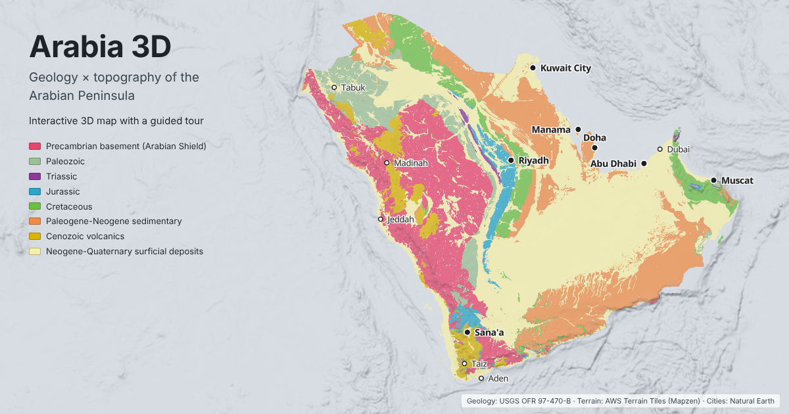

# Arabia 3D — Geology × Topography of the Arabian Peninsula

**Live map: https://kevinalexandr19.github.io/arabian-geology-3d/**

[](https://kevinalexandr19.github.io/arabian-geology-3d/)

Arabia 3D is an interactive 3D map of the generalized bedrock geology of the Arabian Peninsula (Saudi Arabia, Kuwait, Bahrain, Qatar, the UAE, Oman and Yemen), draped over real terrain. It is meant to show at a glance how rock type controls relief: the Precambrian Arabian Shield and the Hijaz–Asir escarpment, the Phanerozoic cover sequence arcing around it in cuesta belts such as Tuwaiq, the Cenozoic harrats, the Rub' al Khali sand sea, the Oman (Hajar) mountains and the Yemen traps. The geology is the USGS 1:2,000,000 compilation, grouped into eight age classes. It runs in any modern browser, on desktop or phone, with nothing to install.

## Features

- **3D terrain** with hillshade and a vertical-exaggeration slider (0–5×).
- **Geology in eight classes** (Precambrian basement to Neogene-Quaternary surficial deposits), with adjustable opacity. Each class can be switched on or off in the legend.
- **Elevation statistics window.** **Elevation statistics** in the side panel opens a window with box plots of the terrain beneath each class and selected features (harrats, Yemen traps, eolian sand, sabkha), a table of values and short observations on the geology–relief correlation.
- **Guided tour** of ten stops (the Arabian Shield, the Hijaz–Asir escarpment, Harrat Rahat and Khaybar, the Arabian Platform, the Tuwaiq escarpment, the Rub' al Khali, the Hajar Mountains, the Yemen highlands, Dhofar, the UAE sabkhas and Musandam). Each stop has a camera preset, a two-sentence caption, flags on key summits, area labels, outlines of the featured units and, where relevant, a traced escarpment. The two overview stops (Shield, Platform) fade every other class. **◀ Prev / Next ▶** in the caption step through the stops by hand.
- **Elevation profile tool.** The **Profile** button (top right) opens a window at the bottom of the map: click two points and get the terrain profile in true metres, filled with the Level 1 colour of the geology underneath, with the vertical exaggeration of the chart and the share of each class. Hover (or drag a finger) along the profile to see distance, elevation and unit, with a matching dot on the map.
- **Stratigraphic column window.** A generalized column of the Arabian Platform (Saq Sandstone to the Hofuf Formation) in the Level 1 colours, with lithology patterns, approximate thicknesses and the escarpment-forming units (Khuff, Tuwaiq Mountain, Jubaila, Aruma, Umm er Radhuma).
- **Explore: geoheritage sites, geoparks and Holocene volcanoes.** Two lists in the side panel (19 curated sites, 17 GVP volcanoes); a click flies to the place and opens a card with a photo (14 sites, from Wikimedia Commons, credited) and a short description, or the last eruption, rock type and a link to the Smithsonian record. The two UNESCO Global Geoparks (Salma and North Riyadh, both designated in 2025) are marked with their designation year. The same points are on the map.
- **Sea-floor depth and plate boundaries.** The sea is shaded by depth from the bathymetry in the terrain tiles, so the Red Sea axial trough and the Gulf of Aden ridge stand out. Plate boundaries (Bird 2003) are drawn as spreading, transform or convergent; click one for its relative velocity.
- **Polygon popups:** click any polygon for its ID, class, finer age label, source age code, age range, lithology note and citation.
- **Cursor readout:** latitude, longitude and true elevation in metres (independent of the exaggeration), bottom left. On a phone, tap the map.
- **Terrain-adjusted contacts.** At the Hajar, Musandam, Asir, Yemen and Dhofar mountain fronts, the 1963 bedrock/alluvium contacts have been moved to the foot of the slope in the modern terrain, so the colours don't spill onto the plain in 3D. Adjusted polygons say so in their popup.
- **Overlays:** 73 cities with regional English names, and motorways, trunk and primary roads from OpenStreetMap.
- **No political borders** are drawn anywhere. The map has no basemap; the coastline comes from the geology itself.

## How to use it

- **Move:** drag to pan, scroll or pinch to zoom. **Tilt and rotate:** right-drag on desktop, two-finger drag on a phone.
- **Tour:** press **Take the tour** on the intro card, or open the **Tour** section of the side panel and pick a stop; **◀ Prev / Next ▶** in the caption move one stop at a time. Any drag or zoom stops the automatic tour; **Home** returns to the whole peninsula.
- **Legend:** switch classes on and off, or use **All on / All off**. On a phone, the **Legend** button opens the panel.
- **Display:** the vertical exaggeration and geology opacity sliders. Lower the opacity to read the hillshade through the colours.
- **Elevation statistics:** opens a window with the per-class elevation box plots and observations.
- **Stratigraphic column:** opens the generalized column of the Arabian Platform.
- **Explore:** pick a geoheritage site, geopark or volcano to fly there.
- **Profile:** the button under the zoom controls; click a start and an end point. **↺ New line** starts again, **×** or Esc closes the tool.
- **Overlays:** switch the sites, volcanoes, plate boundaries and sea-floor shading on or off.
- **About the project:** opens a window with the author, links, data credits and the date of the last update.

The map is a generalized 1:2,000,000-scale compilation for teaching and outreach. It is not for site-specific use.

## Geology classes

Source: USGS Open-File Report 97-470-B (geo2bg), whose only geological attribute is the age code `GLG`. Codes are mapped in [`scripts/geology_classes.csv`](scripts/geology_classes.csv).

**Level 1** is the map colour:

| Class | Colour | geo2bg codes |
|---|---|---|
| Precambrian basement (Arabian Shield) | `#E8456B` | pC, PzpC |
| Paleozoic | `#9DBF95` | Cm, OCm, DSO, D, P, Pz, MzPz |
| Triassic | `#8B3A9A` | Tr, TrP |
| Jurassic | `#2BA6C9` | J, JTr |
| Cretaceous | `#6DBE45` | K, KJ, TK |
| Paleogene-Neogene sedimentary | `#EE8E4A` | T |
| Cenozoic volcanics | `#D9B400` | QTv, Qv, TKv, TKi, Czi |
| Neogene-Quaternary surficial deposits | `#F5EFAA` | Qe, Qf, Q, Qsk, QT |

**Level 2** is an optional label shown in popups, not a colour. It gives a finer age range from the source code (for example Cambrian-Ordovician, Permian-Triassic) or a named feature (Harrats, Yemen traps, Sabkha, Eolian sand, Alluvium and gravel, Neogene-Quaternary gravels, Cenozoic intrusives).

Limits of the source data:
- geo2bg does not subdivide its "Tertiary" unit (T), so Paleocene–Eocene, Oligocene and Miocene–Pliocene are mapped together as Paleogene-Neogene. "Tertiary" is not a formal ICS unit, so it is not used in class names.
- The surficial class is mostly alluvium, gravel and sabkha as well as eolian sand; Level 2 labels separate them. It is Neogene-Quaternary because the geo2bg QT gravels are included.
- The Semail ophiolite and Hawasina allochthon are not separated from the Cretaceous. This is deliberate, since this is a generalized map.

**Extent.** Saudi Arabia, Kuwait, Bahrain, Qatar, the UAE, Oman and Yemen. Neighbouring countries are clipped out. The Socotra archipelago is removed because the source map has no geology there. The Natural Earth country outlines are used only internally, to build the clip mask, and are never drawn.

## Polygon IDs and corrections

Every polygon has a stable ID, `pid` = `AG` + the 5-digit geo2bg `GEO2BG_ID`, shown in its popup. Where the clip mask cuts a source polygon, the pieces get `-a`, `-b`, and so on. All polygons and their labels are listed in [`data/geology_polygons.csv`](data/geology_polygons.csv).

To correct a single polygon, add a row to [`scripts/polygon_overrides.csv`](scripts/polygon_overrides.csv) and rebuild:

```
pid,level1_class,level2_label,notes
AG01234,Triassic,,Khuff outcrop
```

Empty fields keep the value that comes from the polygon's unit. The build stops if a `pid` or class name doesn't exist.

## Rebuild

The site in `docs/` is static and already built; GitHub Pages serves it as is from `/docs` on `main`. To view it locally:

```bash
python -m http.server -d docs
```

Then open http://localhost:8000.

To rebuild the data, use Python 3.11+:

```bash
pip install geopandas "shapely>=2.2" pyproj pyogrio requests matplotlib "osmium>=4.0" rasterio numpy playwright
```

Run the scripts in order from the repository root:

| Step | Command | Output |
|---|---|---|
| 1 | `python scripts/01_download.py` | Natural Earth layers, peninsula clip, pids, `data/geology_polygons.csv`, `data/interim/*` |
| 2 | `python scripts/02_geology.py` | coverage clean + simplify + contact adjustment (`scripts/contacts.py`) → `docs/data/geology.geojson` |
| 3 | `python scripts/03_overlays.py` | `docs/data/cities.geojson`, `docs/data/roads.geojson` |
| 4 | `python scripts/04_elevation_stats.py` | `docs/data/elev_stats.json` (elevation statistics window) |
| 5 | `python scripts/05_units.py` | `docs/data/units.json` (legend classes, popup ages and lithology notes) |
| 6 | `python scripts/06_places.py` | `docs/data/volcanoes.geojson` (GVP), `plates.geojson` (PB2002), `geoheritage.geojson` (from `scripts/geoheritage.csv`), photos in `docs/img/geosites/` (from `scripts/geosite_photos.csv`) |

Checks and figures (the Playwright scripts need the site served on port 8000, as above):

| Command | What it does |
|---|---|
| `python notebooks/contacts_before_after.py` | before/after maps of the contact adjustment → `notebooks/contacts/*.png` |
| `python notebooks/make_preview.py` | renders the 1200×630 link-preview card → `docs/preview.png` |
| `python notebooks/ui_check.py` | interface check, desktop and phone → `notebooks/ui_*.png`, prints console errors |
| `python notebooks/m4_screenshots.py` | one screenshot per tour stop → `notebooks/m4_*.png` |
| `python notebooks/live_check.py` | the same kind of check against the live Pages URL → `notebooks/m5_*.png` |

When you publish changes, update the "Last updated" date in `docs/index.html` by hand.

## Repository layout

```
docs/          the published site: index.html, app.js, style.css, favicons, preview.png, .nojekyll
docs/img/      geosites/*.jpg: credited Commons photos for the geoheritage cards
docs/data/     web layers: geology.geojson, cities.geojson, roads.geojson, units.json, elev_stats.json,
               volcanoes.geojson, plates.geojson, geoheritage.geojson
scripts/       01_download.py … 06_places.py, contacts.py, geology_classes.csv, polygon_overrides.csv, cities.csv,
               geoheritage.csv, geosite_photos.csv
data/raw/      geo2bg shapefile and filtered OSM road extracts in osm/ (committed); Natural Earth zips (gitignored)
data/interim/  clipped and intermediate layers (gitignored)
data/geology_polygons.csv   one row per polygon: pid, unit, labels, area, location
notebooks/     previews, checks and diagnostics (m2_preview, ui_check, m4_screenshots, live_check,
               make_preview, alignment_check, front_offsets, contacts_before_after) and their PNGs
```

## Sources and licences

The **code** in this repository (scripts, viewer, notebooks) is released under the [MIT License](LICENSE). The **data** keep their own licences:

- **Geology:** Pollastro, R.M., 1998, *Bedrock geology of the Arabian Peninsula and selected adjacent areas (geo2bg)*, digital dataset in Pollastro, R.M., Karshbaum, A.S., and Viger, R.J., 1999, *Map showing geology, oil and gas fields and geologic provinces of the Arabian Peninsula*, USGS Open-File Report 97-470-B, https://doi.org/10.3133/ofr97470B. Public domain. Derived from the USGS–ARAMCO 1:2,000,000 geologic map (1963).
- **Terrain:** [AWS Open Data Terrain Tiles](https://registry.opendata.aws/terrain-tiles/) (Mapzen, Terrarium encoding), built from SRTM, GMTED2010, ETOPO1 and other sources listed in the [dataset attribution](https://github.com/tilezen/joerd/blob/master/docs/attribution.md).
- **Roads:** © [OpenStreetMap contributors](https://www.openstreetmap.org/copyright), Geofabrik extracts of 2026-11-03. `docs/data/roads.geojson` and `data/raw/osm/*.osm.pbf` are licensed under the [Open Database License (ODbL) 1.0](https://opendatacommons.org/licenses/odbl/1-0/): you may copy, share and adapt them if you credit "© OpenStreetMap contributors" and share any public adapted database under the ODbL.
- **Holocene volcanoes:** Global Volcanism Program, *Volcanoes of the World* (v. 5), Smithsonian Institution, https://doi.org/10.5479/si.GVP.VOTW5, read from the GVP web service. Free to use with citation. The short notes in the volcano cards are written for this map.
- **Plate boundaries:** Bird, P., 2003, An updated digital model of plate boundaries, *Geochemistry, Geophysics, Geosystems* 4(3), 1027, https://doi.org/10.1029/2001GC000252; GeoJSON by Hugo Ahlenius, Nordpil ([fraxen/tectonicplates](https://github.com/fraxen/tectonicplates)), ODC-BY 1.0.
- **Bathymetry** in the sea-floor shading comes from the same AWS Terrain Tiles (ETOPO1 and GEBCO-derived sources).
- **Geoheritage sites:** curated for this map in `scripts/geoheritage.csv` (approximate coordinates and own descriptions). UNESCO Global Geopark names and designation years from the [UNESCO list of geoparks](https://www.unesco.org/en/iggp/geoparks).
- **Geosite photos:** Wikimedia Commons, one per site, listed with author and licence in `scripts/geosite_photos.csv` (CC BY 2.0/4.0, CC BY-SA 3.0/4.0 or public domain). They are resized to 720 px (`docs/img/geosites/`) and credited under each photo in the viewer; the CC BY-SA photos remain under CC BY-SA. **Stratigraphic column:** generalized after Powers et al. (1966, USGS Professional Paper 560-D), Le Nindre et al. (1990) and Sharland et al. (2001).
- **Cities and clip mask:** [Natural Earth](https://www.naturalearthdata.com/) 1:10m, public domain.
- **Viewer library:** [MapLibre GL JS](https://maplibre.org/) 5.6.0, BSD-3-Clause. Label glyphs from `demotiles.maplibre.org`.

## Credits and dedication

Made by Kevin Alexander Gomez ([LinkedIn](https://www.linkedin.com/in/kevin-alexander-gomez/), [GitHub](https://github.com/kevinalexandr19)), with [Claude](https://claude.ai).

Dedicated to KFUPM (King Fahd University of Petroleum & Minerals) and its College of Petroleum Engineering and Geosciences (CPG).

---

## Technical notes

### Processing

`01_download.py` downloads the Natural Earth layers into `data/raw/naturalearth/`, reads the OpenStreetMap road extracts in `data/raw/osm/`, clips everything with the peninsula mask and writes the clipped layers to `data/interim/`. The mask is the Natural Earth 10m admin-0 polygons of the seven states, buffered 0.2° seaward, minus all other countries (median line against neighbours' coasts), minus Socotra. It regenerates `data/geology_polygons.csv` and prints a summary.

`02_geology.py` cleans the polygon coverage (GEOS CoverageCleaner, so shared edges match vertex-for-vertex), applies topology-preserving coverage simplification (tolerance 0.004°, no dissolve, every `pid` kept), adjusts mountain-front contacts (below), rounds coordinates to 4 decimals and writes `docs/data/geology.geojson` (~7.0 MB, ~1.9 MB gzipped as served). It stops if the pid set differs from `data/geology_polygons.csv`, if any geometry is empty or invalid, or if gaps or overlaps appear. Shapely ≥ 2.2 (GEOS ≥ 3.14) is needed for `coverage_clean`.

### Mountain-front contact adjustment

geo2bg was drawn at 1:2,000,000 in 1963. At mountain fronts the mapped bedrock/alluvium contact is typically 1–2 km from the foot of the slope in the SRTM-based terrain, so in 3D the colours spill onto the plain or up the slope. There is no systematic shift that a single nudge or warp could fix (`notebooks/alignment_check.py`); the offset is local (`notebooks/front_offsets.py`). `02_geology.py` therefore moves these contacts, and only these, with `scripts/contacts.py` (parameters at the top of that file):
- **Which contacts:** shared edges with bedrock (any class except the surficial one) on one side and alluvium, gravel or sabkha on the other. Eolian sand is excluded because dunes have their own slopes.
- **Where:** four areas — Hajar and Musandam, Asir and Tihamah, Yemen highlands, Dhofar.
- **Finding the foot:** every 300 m along a contact, a z10 slope profile (~140 m pixels) is taken across it. The contact moves to the foot of the slope only where there is a clear front: ≥ 8° within 0.3–1.5 km on the bedrock side and ≤ 6° within 0.3–1.5 km on the plain side. Flat plateaux and pediments are not touched.
- **Smoothing:** moves are smoothed along the contact, capped at 5 km, and fade to zero away from measured stretches and at junctions. Junctions never move.
- **Safety:** a move that would cross or swallow another boundary is scaled down or dropped.
- **Result:** polygons are rebuilt from their edges, so the coverage stays gap- and overlap-free and every pid is kept. 115 contacts moved in 108 polygons, and 1,241 km² reassigned between bedrock and alluvium (mostly bedrock → alluvium). In Asir the main escarpment lies inside the Precambrian in geo2bg, so only isolated ridges changed there.
- **Not adjusted:** contacts between two bedrock units and harrat edges, because slope does not define them.
- **Flag:** adjusted polygons carry `contact_adjusted: 1`. The unadjusted version is kept in `data/interim/geology_web_unadjusted.gpkg`. Run `python scripts/02_geology.py --no-adjust` to skip the step.
- **Before/after maps:** `notebooks/contacts/*.png` — Before, After and Change panels on hillshade: red = bedrock → alluvium, blue = alluvium → bedrock, dashed = old contact, solid = new contact.

### Overlays

`03_overlays.py` writes `docs/data/cities.geojson` and `docs/data/roads.geojson`. Cities: all 73 Natural Earth places in the extent (Hawalli dropped as part of Kuwait City), named in regional English usage (Madinah, Jazan, Sohar, Sana'a, …) with curated Arabic names, both from [`scripts/cities.csv`](scripts/cities.csv); edit that file to rename or drop a city. Roads: OpenStreetMap `highway=motorway|trunk|primary` (~98,800 km), merged per (class, `ref`), or per (class, name) where there is no ref, giving 1,400 features (1.5 MB). Geometry is simplified at 0.001° (~100 m), parts under 0.5 km are dropped and coordinates are rounded to 4 decimals. Natural Earth roads were used before; they were dropped because they are generalized for 1:10M, miss recent highways and misclassify trunk routes.

The OSM data are Geofabrik extracts (`gcc-states`, `yemen`, 2026-11-03) filtered to the three road classes and committed to `data/raw/osm/` (8 MB). To refresh, download https://download.geofabrik.de/asia/gcc-states-latest.osm.pbf and https://download.geofabrik.de/asia/yemen-latest.osm.pbf, then run `python scripts/01_download.py --osm-extract <download dir> <YYMMDD>` and update `OSM_FILES` in `01_download.py`.

### Legend and popup data

`05_units.py` writes `docs/data/units.json` from `scripts/geology_classes.csv`: the legend classes (order, colours, codes) and, per `GLG` code, the age range and a short generalized lithology note shown in the popups. geo2bg has no lithology attribute, so these notes are a regional summary kept in the script.

`04_elevation_stats.py` downloads the 90 AWS Terrarium tiles at zoom 7 that cover the geology (cached in `data/interim/terrarium/`), decodes elevation as R×256 + G + B/256 − 32768 and mosaics them on their native EPSG:3857 grid (~1.22 km/px). It rasterizes `docs/data/geology.geojson` onto the same grid and computes min, p10, median, p90, max, pixel count and pixels below 0 m, per Level 1 class and per Level 2 label. Each pixel counts once. Negative values (coastal pixels on bathymetry) are kept. Web-Mercator pixel area shrinks northwards (cos lat); this is ignored. The **Elevation statistics** window draws the result as box plots on a shared 0–3,700 m scale, with observations whose numbers are read from the JSON. The Sabkha sanity check (median near 0 m) fails because the inland sabkhas (Umm as Samim, Rub' al Khali interdune flats, Al Jafr) lift the median to ~56 m; coastal sabkhas sit at 0–10 m.

### Viewer

`docs/` is the whole site, with no build step: `index.html`, `app.js`, `style.css` and `data/`. It uses MapLibre GL JS 5.6.0 from unpkg and no basemap (plain background, so no third-party borders). Terrain and hillshade come from the AWS Terrarium tiles; label glyphs (Noto Sans) from `demotiles.maplibre.org`. The page loads ~8.5 MB of GeoJSON uncompressed, ~2.2 MB gzipped. `docs/.nojekyll` tells GitHub Pages to serve the files as is, without a Jekyll build.

- **Tour stops** are the `STOPS` array in `docs/app.js`: a `camera` preset (or `bounds` fitted to the screen, for the overview stops), caption and `marks` (`marks.dim` fades every class not listed). Flags sit on the z7 DEM maxima near each summit (heights are the commonly quoted values). Flags and area labels are DOM markers, so terrain never hides them. The dashed escarpment traces for Asir and Tuwaiq were derived from the z7 Terrarium mosaic (steepest eastward rise over ~5–7 km every 0.25° of latitude) and are approximate at the ~1–5 km level. The tour waits ~4.5 s after each 3.5 s flight.
- **Explore cards** reuse the tour caption (`showPlace` in `docs/app.js`). Geoheritage cameras (zoom, pitch, bearing) are columns in `scripts/geoheritage.csv`; volcanic fields open at zoom 8, single edifices at 10.5.
- **Elevation profile:** 400 samples on a straight lon/lat line, elevations decoded from Terrarium tiles at a zoom that suits the line length (z12 below 25 km down to z7 above 800 km), geology by point-in-polygon on `geology.geojson`. The chart's vertical exaggeration is computed from its own axes.
- **Sea-floor shading** is a MapLibre `color-relief` layer on a third Terrarium source, transparent above 0 m.
- **Stratigraphic column:** the `STRAT` array in `docs/app.js` (units, ages, thickness, lithology, resistance 1–3); edit it there.
- **Cursor readout:** elevation is decoded from the Terrarium tile under the cursor (z7–z12, depending on zoom), so it is in true metres whatever the exaggeration.
- **Icon:** `docs/favicon.svg` is the peninsula outline filled with concentric bands in the Level 1 colours; `favicon-32.png` and `apple-touch-icon.png` are rendered from it.
- **Link preview:** `docs/preview.png` (1200×630) is the `og:image` card shown when the link is shared. The meta tags in `docs/index.html` use absolute GitHub Pages URLs.

### Milestones

| Milestone | State |
|---|---|
| M1 — data acquisition, clipping, classification, polygon IDs | done |
| M2 — simplified GeoJSON for the web | done |
| M3 — MapLibre 3D viewer | done |
| M4 — tour bookmarks and per-class elevation stats | done |
| M5 — publish on GitHub Pages | done |
